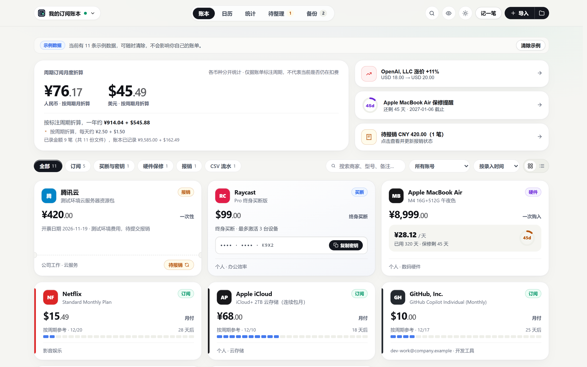
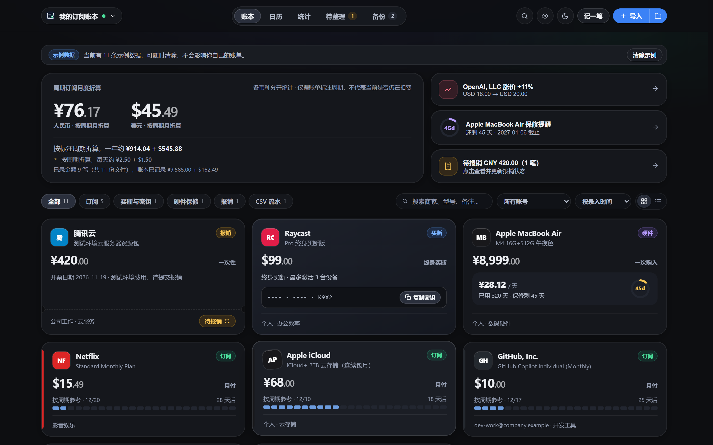
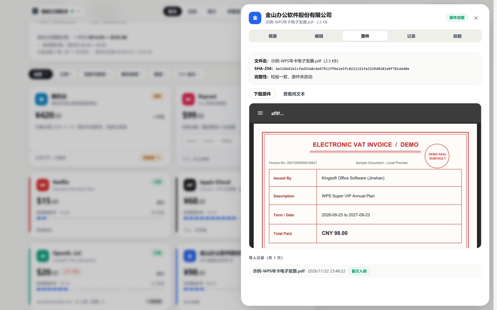
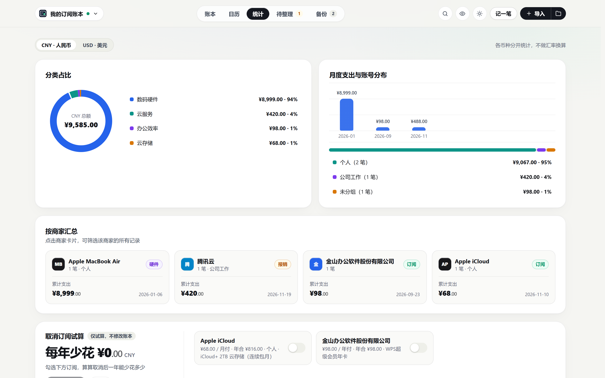
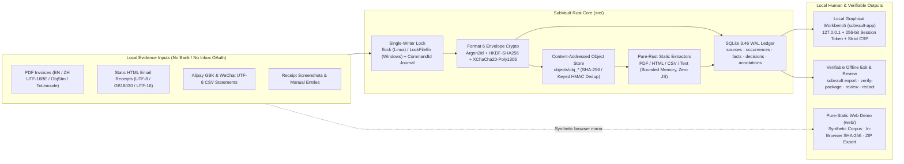

# SubVault

**Local-first, SHA-256 verifiable subscription, invoice, hardware warranty, and software-license vault — zero bank logins, zero inbox OAuth, and zero fabricated "Active/Expired" guesses.**

[](https://github.com/Yanagi42/SubVault/actions/workflows/ci.yml)
[](https://github.com/Yanagi42/SubVault/actions/workflows/pages.yml)


### Quick Links

- **Live Static Web Demo (GitHub Pages):** **[https://yanagi42.github.io/SubVault/](https://yanagi42.github.io/SubVault/)** — preloaded synthetic corpus, SHA-256 duplicate detection, inline `correct`/`undo`, native CLI export verifier (`Open Native Export`), and `.zip` offline exit download
- **Portable Bundles & Release Notes:** **[Releases](https://github.com/Yanagi42/SubVault/releases)** · [Release Notes (`RELEASE_NOTES.md`)](./RELEASE_NOTES.md) · [Changelog (`CHANGELOG.md`)](./CHANGELOG.md)
- **Roadmap, Security & Contributing:** [Roadmap (`docs/ROADMAP.md`)](./docs/ROADMAP.md) · [Technical Spec (中文)](./docs/SPEC-zh.md) · [Security Policy (`SECURITY.md`)](./SECURITY.md) · [Contributing (`CONTRIBUTING.md`)](./CONTRIBUTING.md)

> **UI Language Note:** The `subvault-app` graphical workbench UI is currently written in **Simplified Chinese** and parses both **English and Chinese** real-world invoices, receipts, and Alipay/WeChat CSV statements. The `subvault` CLI and static `web/` demo are in English.

---

## Screenshots

### Local Encrypted Workbench (`subvault-app`) — Light & Dark Overview
*Multi-currency recurring equivalents kept strictly separated by currency, price-drift & warranty/reimbursement radar, perpetual license key vaulting (masked on screen, encrypted at rest, omitted from CSV), and daily hardware cost tracking.*





### Evidence Drawer & Original PDF Verification
*Inspect preserved original PDFs, sandboxed static HTML emails, and receipt images alongside their SHA-256 hashes, import occurrence history, append-only human edits, and one-click PII redaction.*



### Category Analytics, Vendor Portfolio & Cancellation Simulator
*Per-currency category breakdowns, monthly spend trend, account separation, per-vendor cumulative history, and an offline "what-if" cancellation simulator that never mutates the ledger.*



### Pure-Static Web Demo (`web/`)
*Zero-backend browser demo running the synthetic T0 corpus with real SHA-256 deduplication and conflict auditing.*


---

## Why SubVault?

Most subscription trackers force an uncomfortable trade-off:
- **Bank and inbox scrapers** require banking credentials or email OAuth, discard original PDF/HTML receipts, merge personal and work accounts under the same merchant, and fabricate "Active" or "Expired" states.
- **Manual folders and spreadsheets** duplicate records whenever you re-import a directory and overwrite prior edits.

SubVault is built around **evidence-first local custody**:
1. **Immutable Original Custody:** Raw file bytes are stored untouched under `objects/obj_<id>` (chunk-encrypted with XChaCha20-Poly1305 in passphrase vaults) and checked against SHA-256. Filenames and folder paths are never identity.
2. **Byte-Identical Deduplication:** Re-importing renamed or repeated files reuses the stored object via keyed HMAC-SHA256 (or SHA-256 in OS-disk mode) and appends a new `occ_*` occurrence without duplicating spend or overwriting human edits.
3. **Epistemic Honesty:** Amounts parsed from receipts stay explicitly marked `payment_verified=false`; past service periods never fabricate an "Expired" or "Cancelled" state; refunds, credit notes, and unpaid order totals are never adopted as paid spend; masked accounts stay unassigned until you confirm them.
4. **Append-Only Human Decisions:** `correct`, `undo`, and `record-fact` append auditable revisions in SQLite while keeping original bytes untouched.
5. **Verifiable Offline Exit:** Export a self-contained exit pack (`records.json`, `facts.csv`, `manifest.json`, `originals/`) or an Excel UTF-8 BOM ledger CSV at any time, and verify every original independently via `subvault verify-package` — zero lock-in.

---

## Architecture



---

## Quick Start

### 1. Launch the Local Graphical Workbench (`subvault-app`, Recommended)
Build from source with `cargo build --release --locked` or unpack a portable release bundle, then run:
- **Windows:** double-click `subvault-app.exe` (or run `.\target\release\subvault-app.exe`)
- **Linux:** `./subvault-app` (or `./target/release/subvault-app`)
- **Via CLI:** `subvault app`

What works locally with zero cloud dependency:
- Initialize or unlock a **Format 6** vault with application-layer AEAD encryption (`Argon2id` + `XChaCha20-Poly1305` + offline `SVRK-...` recovery key) or OS full-disk encryption mode.
- Drag and drop individual files or entire folders of **PDF invoices** (supporting `/ObjStm`, PNG predictors, `/ToUnicode` Chinese CMaps, Form XObjects, and UTF-16BE), **styled HTML receipts** (UTF-8 / GB18030 / UTF-16), **Alipay / WeChat CSV statements**, or **receipt images** (`.png` / `.jpg` / `.webp`).
- Load the built-in **Demo Pack** (sample e-fapiao PDFs, HTML receipts, Alipay CSV, receipt screenshot, license key, hardware warranty, and reimbursable invoice) and clear it in one click without touching real data.
- Inspect originals inline, resolve missing/conflicting amounts in Quick Triage, generate PII-redacted templates via `subvault redact`, and export Excel CSVs or SHA-256 verifiable `.zip` / directory exit packs.

### 2. Try the Static Web Demo (Synthetic Corpus Only)
Open **[https://yanagi42.github.io/SubVault/](https://yanagi42.github.io/SubVault/)** to explore the 12-file synthetic corpus directly in your browser:
- Import renamed duplicate copies to test byte-identical SHA-256 reuse.
- Inspect raw bytes, run inline `Correct Amount` / `Undo`, or open a native CLI export directory with `Open Native Export`.
- Download a verifiable `.zip` offline exit bundle directly from the browser.

### 3. Build & Run Portable Release Bundles

**Windows (`x86_64`):**
```powershell
pwsh -File scripts/package-release-windows.ps1
# Produces dist\subvault-v0.1.0-windows-x86_64.zip and dist\SHA256SUMS-windows.txt
```
Unzip the bundle and double-click `subvault-app.exe` (or run `.\run-demo.ps1 -Mode cli` / `.\run-demo.ps1 -Mode web`).

**Linux (`x86_64`):**
```bash
bash scripts/package-release.sh
(cd dist && sha256sum -c SHA256SUMS.txt)
unzip dist/subvault-v0.1.0-linux-x86_64.zip
cd subvault-v0.1.0-linux-x86_64
./subvault-app         # Launch local graphical workbench
./run-demo.sh cli      # End-to-end CLI PDF + dedup + HTML + export + verify-package walkthrough
./run-demo.sh web      # Serve pure-static Web Demo at http://127.0.0.1:4173
```

### 4. Build & Test from Source

**Prerequisites:** Rust `1.83+`, Python `3`, Node.js `20+` (for Web Demo & interop tests), and on Linux `sqlite3` + `gcc`.

**Linux:**
```bash
python3 synthetic/generate_corpus.py --check
SUBVAULT_GIT_SHA=$(git rev-parse HEAD) cargo build --release --locked
SUBVAULT_GIT_SHA=$(git rev-parse HEAD) cargo test --locked -- --test-threads=1
node --check app/app.js && node scripts/test-web.mjs
```

**Windows (`pwsh`):**
```powershell
python synthetic/generate_corpus.py --check
cargo build --release --locked
cargo test --locked --lib --test windows_native --test format6_crypto --test redact --test real_bills --test workbench_e2e --test pdf_bill --test verify_package --test review_sheet --test review_snapshot -- --test-threads=1
node --check app/app.js; node scripts/test-web.mjs
```

### 5. Native CLI Walkthrough (Format 6 Encrypted Vault + Redacted Template + Verifiable Exit)

```bash
# 1. Initialize an isolated Format 6 real-data vault with application-layer AEAD encryption
#    (raw secrets are never accepted as CLI flags; use --passphrase-file, --passphrase-stdin, or SUBVAULT_PASSPHRASE_FILE)
./target/release/subvault init \
  --vault /tmp/my-real-vault \
  --format 6 \
  --protection passphrase \
  --passphrase-file ./passphrase.txt \
  --recovery-key-out /tmp/recovery-key.txt

# 2. Preserve & extract a static text-PDF receipt (or `html`, `csv`, `fragment`)
./target/release/subvault pdf \
  --vault /tmp/my-real-vault \
  --command-id cmd-pdf-1 \
  --source ./synthetic/corpus/originals/v-2026-09-receipt.pdf \
  --passphrase-file ./passphrase.txt

# 3. Export a SHA-256 verifiable offline exit package (explicit plaintext ack required for encrypted vaults)
./target/release/subvault export \
  --vault /tmp/my-real-vault \
  --out /tmp/my-export-pack \
  --acknowledge-plaintext yes \
  --passphrase-file ./passphrase.txt

# 4. Independently verify the exported package without needing the live vault
./target/release/subvault verify-package \
  --package /tmp/my-export-pack

# 5. Generate a lock-consistent plain-text review sheet linked to verified originals
./target/release/subvault review \
  --vault /tmp/my-real-vault \
  --out /tmp/review.txt \
  --package /tmp/my-export-pack \
  --passphrase-file ./passphrase.txt

# 6. Export a PII-redacted text template before reporting a broken bill layout
./target/release/subvault redact \
  --vault /tmp/my-real-vault \
  --source-id <src_id> \
  --out /tmp/redacted-template.txt \
  --redact-term "MyName" \
  --passphrase-file ./passphrase.txt
```

*(Prefer OS full-disk encryption instead of application-layer AEAD? Initialize with `--format 6 --protection os-disk`. Synthetic test vaults Formats 1–5 remain strictly isolated with `SYNTHETIC_ONLY`.)*

---

## Repository Layout

| Path | Purpose |
| --- | --- |
| `src/` | Rust preservation engine, SQLite WAL store, Format 6 envelope crypto (`Argon2id` + `HKDF-SHA256` + `XChaCha20-Poly1305`), pure-Rust PDF/HTML/CSV/text extractors, append-only decision chain, offline exit exporter, standalone `verify-package`, review sheet renderer, `redact` sanitizer, and loopback `subvault-app` HTTP server |
| `app/` | Embedded local graphical workbench frontend (`index.html`, `styles.css`, `app.js`, `icon.svg`) served exclusively on `127.0.0.1` by `subvault-app` |
| `tests/` | 26 integration and backward-compatibility suites (Format 1–6 isolation, AEAD zero-plaintext & tamper proofs, bilingual real bills, workbench E2E security & workflow, PII redaction, PDF/HTML extraction, crash/fault hooks, Linux `renameat2(RENAME_NOREPLACE)`, and Windows `LockFileEx`/`FileIdInfo`/junctions) |
| `web/` | Zero-dependency, subpath-safe pure-static Web Demo (`index.html`, `app.js`, `engine.js`, `demo-data.js`, `pdf.js`, `zip.js`, `styles.css`) |
| `synthetic/` | Deterministic T0 corpus generator and byte/logical test fixtures |
| `scripts/` | Portable release packagers (`package-release.sh`, `package-release-windows.ps1`), Web Demo & CLI-interop test runner (`test-web.mjs`), screenshot capture helper (`capture-screenshots.py`), and T1 evidence script |
| `.github/` | Linux + Windows CI (`ci.yml`), manual GitHub Pages deploy (`pages.yml`), release workflow (`release.yml`), and issue templates |
| `docs/` | High-DPI workbench & Web Demo screenshots (`docs/screenshots/`), release roadmap (`docs/ROADMAP.md`), and full Chinese technical specification (`docs/SPEC-zh.md`) |

---

## Verified Guarantees & Honest Boundaries (`v0.1.0`)

- **Real-Data Format 6 & At-Rest Encryption (`src/crypto.rs`, `src/store.rs`):** Dedicated non-synthetic Format 6 (`SUBVAULT_VAULT` banner, `synthetic_only=false`, `real_data_import=available`) isolated from synthetic Formats 1–5. Supports `--protection passphrase` (`Argon2id` + `HKDF-SHA256` + `XChaCha20-Poly1305` across `objects/`, `staging/`, `journal/`, and sensitive SQLite cells, `PRAGMA secure_delete = ON`, keyed `HMAC-SHA256` dedup, offline `SVRK-...` recovery keys, `rotate-passphrase`, `EXIT_AUTH = 22`) or `--protection os-disk`.
- **Single-Binary Local Workbench (`subvault-app` / `subvault app`):** Loopback `127.0.0.1` only, 256-bit session token via `X-SubVault-Token`, strict `Host`/`Origin`/`Sec-Fetch-Site` and CSP guards, serialized per-vault locking, in-memory `Zeroizing` DEK, zero temporary plaintext on `.zip` exports, and Excel CSV formula neutralization.
- **Cross-Platform Preservation:** Verified on **Windows 11 NTFS (`x86_64-pc-windows-msvc`)** (`CreateFileW` + `LockFileEx`, 128-bit `FileIdInfo`, atomic `FileRenameInfo` no-replace, UNC/network-share refusal; 83 unit & integration tests passing natively on Windows) and **Linux (`x86_64-unknown-linux-gnu`)** (`flock`, `renameat2(RENAME_NOREPLACE)`, parent fd `fsync`, full 26 integration suites in CI).
- **Explicit Non-Goals in `v0.1.0`:** No bank/card API syncing, no email OAuth scraping, no OCR on scanned images (preserved intact for Quick Triage manual entry), no cloud sync, and no guessed subscription renewal states beyond what source documents actually record.

For the exhaustive contract of exit codes (`0`–`22`), crash/recovery semantics, and Format 1–6 invariants, see [`docs/SPEC-zh.md`](./docs/SPEC-zh.md).

---

## License

Dual-licensed under either of:

- **MIT License** ([`LICENSE-MIT`](./LICENSE-MIT))
- **Apache License, Version 2.0** ([`LICENSE-APACHE`](./LICENSE-APACHE))

at your option. Unless you explicitly state otherwise, any contribution intentionally submitted for inclusion in SubVault by you, as defined in the Apache-2.0 license, shall be dual licensed as above, without any additional terms or conditions.
