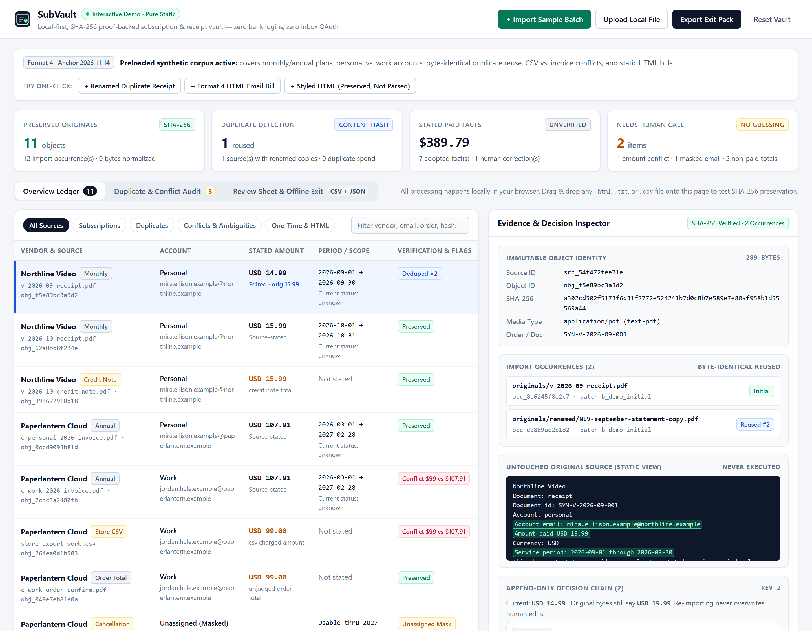
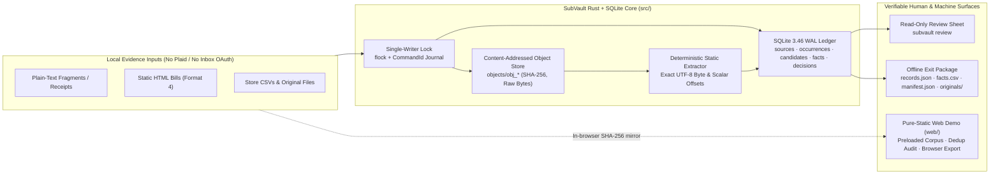

# SubVault

**Local-first, SHA-256 verifiable subscription, invoice, and software-license vault — zero bank logins, zero inbox OAuth, and zero fabricated "Active/Expired" guesses.**

[](https://github.com/Yanagi42/SubVault/actions/workflows/ci.yml)
[](https://github.com/Yanagi42/SubVault/actions/workflows/pages.yml)


### Quick Links

- **Live Interactive Demo (GitHub Pages):** **[https://yanagi42.github.io/SubVault/](https://yanagi42.github.io/SubVault/)** — preloaded synthetic corpus, one-click sample import, real SHA-256 duplicate detection, inline `correct`/`undo` & masked-account attribution, native CLI export verifier (`Open Native Export`), and one-click `.zip` offline exit download
- **Portable Bundles & Draft Release Notes:** **[Releases](https://github.com/Yanagi42/SubVault/releases)** · [Draft Release Notes (`RELEASE_NOTES.md`)](./RELEASE_NOTES.md) · [Changelog (`CHANGELOG.md`)](./CHANGELOG.md)
- **Path to `v0.1.0` & Full Technical Spec:** [Roadmap (`docs/ROADMAP.md`)](./docs/ROADMAP.md) · [Full Technical Verification Spec (中文)](./docs/SPEC-zh.md)

---

## Screenshots

### Overview Ledger & Evidence Inspector
*Preloaded synthetic corpus showing separated personal/work accounts, byte-identical duplicate reuse (`Deduped ×2`), CSV-vs-invoice conflict flags, untouched static source preview, and append-only human decision history.*



### Duplicate Detection & Conflict Audit
*SHA-256 content-hash deduplication across renamed copies, side-by-side `$107.91` invoice vs. `$99.00` store CSV conflict isolation, same-merchant multi-account separation, and masked cancellation handling.*


---

## Why SubVault?

Existing subscription trackers force a bad trade-off:
- **Bank/email scrapers** demand Plaid credentials or inbox OAuth, lose the original PDF/HTML receipts, merge personal and work accounts at the same merchant, and guess "Active / Expired" states.
- **Manual spreadsheets & receipt folders** duplicate entries whenever you re-import a folder and clobber manual fixes.

SubVault takes a strict **evidence-first** design:
1. **Immutable Original Custody:** Raw document bytes are stored untouched under `objects/obj_<id>` and verified by SHA-256. Path and filename are never identity.
2. **Automatic Byte-Identical Deduplication:** Re-importing renamed or duplicate files reuses the stored object and records a new `occ_*` occurrence — never duplicating spend and never overwriting prior human edits.
3. **Epistemic Honesty (No Guessing):** Source-stated paid amounts are explicitly marked `payment_verified=false`; ended service periods keep `current_status=unknown`; cancelled auto-renewals stay usable through the stated date; masked emails stay unassigned; credit notes and order totals never masquerade as paid invoices.
4. **Append-Only Human Decisions:** `correct` and `undo` append auditable revisions while preserving the untouched original bytes verbatim.
5. **Verifiable Offline Exit:** One command writes a self-contained exit package (`records.json`, `facts.csv`, `manifest.json`, `originals/`) with SHA-256 hashes and explicit `complete` / `partial` reporting — zero lock-in.

---

## Architecture



---

## Quick Start

### 1. Try the Live Demo (Zero Install)
Open **[https://yanagi42.github.io/SubVault/](https://yanagi42.github.io/SubVault/)**:
- Browse the preloaded 12-file synthetic corpus immediately.
- Click **`+ Import Sample Batch`** or **`+ Renamed Duplicate Receipt`** to watch SHA-256 deduplication reuse objects without duplicating spend or losing human edits.
- Click any row to inspect raw bytes, run **`Correct Amount`** / **`Undo`**, or switch to **`Review Sheet & Offline Exit`** to download `facts.csv`, `records.json`, and `manifest.json`.

### 2. Build & Run the Portable Bundle (Linux x86_64)
Build locally with `bash scripts/package-release.sh` (or download from [GitHub Releases](https://github.com/Yanagi42/SubVault/releases) once `v0.1.0` is published):

```bash
(cd dist && sha256sum -c SHA256SUMS.txt)
unzip dist/subvault-v0.1.0-linux-x86_64.zip
cd subvault-v0.1.0-linux-x86_64

# Run an end-to-end Format 5 PDF + duplicate reuse + HTML + export + verify-package + review walkthrough
./run-demo.sh cli

# Or serve the offline pure-static Web Demo locally at http://127.0.0.1:4173
./run-demo.sh web
```

### 3. Build & Test from Source

**Prerequisites (Linux):** Rust `1.83+`, `python3`, `sqlite3`, `gcc`, and `node` (for Web Demo tests).

```bash
# 1. Verify the deterministic synthetic T0 corpus
python3 synthetic/generate_corpus.py --check

# 2. Build the native Rust CLI binary
SUBVAULT_GIT_SHA=$(git rev-parse HEAD) cargo build --release --locked

# 3. Run the full Rust unit & integration suite (all 19 behavior & compatibility suites)
SUBVAULT_GIT_SHA=$(git rev-parse HEAD) cargo test --locked -- --test-threads=1

# 4. Run Web Demo SHA-256, dedup, and subpath asset tests
node scripts/test-web.mjs

# 5. Build portable release bundles + SHA256SUMS.txt into dist/
bash scripts/package-release.sh
```

### 4. Native CLI Walkthrough (Format 6 Real-Data Encrypted Vault + Redacted Template + Verifiable Exit)

```bash
# 1. Initialize an isolated Format 6 real-data vault with application-layer AEAD encryption
#    (never pass raw secrets as CLI flags — use --passphrase-file, --passphrase-stdin, or SUBVAULT_PASSPHRASE_FILE)
./target/release/subvault init \
  --vault /tmp/my-real-vault \
  --format 6 \
  --protection passphrase \
  --passphrase-file ./passphrase.txt \
  --recovery-key-out /tmp/recovery-key.txt

# 2. Preserve & extract a static text-PDF receipt (or static HTML / text fragment)
./target/release/subvault pdf \
  --vault /tmp/my-real-vault \
  --command-id cmd-pdf-1 \
  --source ./synthetic/corpus/originals/v-2026-09-receipt.pdf \
  --passphrase-file ./passphrase.txt

# 3. Export a SHA-256 verifiable offline exit package (requires explicit plaintext ack on encrypted vaults)
./target/release/subvault export \
  --vault /tmp/my-real-vault \
  --out /tmp/my-export-pack \
  --acknowledge-plaintext yes \
  --passphrase-file ./passphrase.txt

# 4. Independently verify the exported package without needing the live vault
./target/release/subvault verify-package \
  --package /tmp/my-export-pack

# 5. Generate a lock-consistent plain-text review sheet linked to verified originals
./target/release/subvault review \
  --vault /tmp/my-real-vault \
  --out /tmp/review.txt \
  --package /tmp/my-export-pack \
  --passphrase-file ./passphrase.txt

# 6. Export a redacted human-inspectable template (for safely reporting broken bill layouts)
./target/release/subvault redact \
  --vault /tmp/my-real-vault \
  --source-id <src_id> \
  --out /tmp/redacted-template.txt \
  --redact-term "MyName" \
  --passphrase-file ./passphrase.txt
```

*(Prefer OS full-disk encryption instead of application-layer AEAD? Initialize with `--format 6 --protection os-disk`. Synthetic test vaults Formats 1–5 remain strictly isolated with `SYNTHETIC_ONLY`.)*

---

## Repository Layout

| Path | Purpose |
| --- | --- |
| `src/` | Rust preservation engine, SQLite WAL store, pure-Rust Format 6 envelope crypto (`Argon2id` + `HKDF-SHA256` + `XChaCha20-Poly1305`), static text/HTML/PDF extractors, append-only decision chain, offline exporter, standalone verifier, review sheet renderer, and deterministic `redact` template exporter |
| `tests/` | 24 integration & backward-compatibility test suites (including `format6_crypto.rs`, `redact.rs`, `windows_native.rs`, `pdf_bill.rs`, `verify_package.rs`, crash/fault hooks, WAL/header consistency, Linux `renameat2(RENAME_NOREPLACE)`, and Windows `LockFileEx`/`FileIdInfo`/junctions) |
| `web/` | Zero-dependency, subpath-safe pure-static interactive Web Demo (`index.html`, `app.js`, `engine.js`, `demo-data.js`, `pdf.js`, `zip.js`, `styles.css`) |
| `synthetic/` | Deterministic T0 corpus generator and independent byte/logical expectations |
| `scripts/` | Release packaging (`package-release.sh`, `package-release-windows.ps1`), Web Demo & CLI-interop checks (`test-web.mjs`), screenshot capture (`capture-screenshots.py`), and T1 evidence script |
| `.github/workflows/` | Automated Linux + Windows CI (`ci.yml`), manual GitHub Pages deployment (`pages.yml`), and multi-platform release publishing (`release.yml`) |
| `docs/` | Real UI screenshots (`docs/screenshots/`), next-iteration roadmap (`docs/ROADMAP.md`), and the complete Chinese technical specification (`docs/SPEC-zh.md`) |

---

## Current Status & Honest Boundaries

SubVault intentionally separates **verified guarantees** from **unbuilt milestones**:

- **Verified today (pre-`v0.1.0`):**
  - **Real-Data Format 6 & At-Rest Encryption (`src/crypto.rs`, `src/redact.rs`):** Dedicated non-synthetic Format 6 (`SUBVAULT_VAULT` banner, `synthetic_only=false`, `real_data_import=available`) isolated from disposable Formats 1–5, supporting explicit `--protection passphrase` (pure-Rust `Argon2id` + `HKDF-SHA256` + `XChaCha20-Poly1305` envelope encryption for `objects/`, `staging/`, `journal/`, and sensitive SQLite cells, keyed `HMAC-SHA256` dedup, offline `SVRK-...` recovery keys, `rotate-passphrase`, dedicated `EXIT_AUTH = 22`, and mandatory `--acknowledge-plaintext yes` on `export`) or `--protection os-disk`, plus local-only `subvault redact` template sanitization.
  - **Linux (`x86_64-unknown-linux-gnu`):** Single-writer preservation (`flock`, SQLite 3.46 WAL `synchronous=FULL`, `renameat2(RENAME_NOREPLACE)` + parent fd `fsync`), Format 1–6 isolation, deterministic UTF-8 fragment, constrained static HTML (`tl` 0.7.8), and static text-PDF (`FlateDecode` via `miniz_oxide`, 1-based `pdf_page` locators) extraction, append-only human `correct`/`undo`, verifiable `offline-exit-1` export & standalone `verify-package`, and read-only `review` sheets.
  - **Windows (`x86_64-pc-windows-msvc`):** Native Win32 `CreateFileW` + `LockFileEx` two-process single-writer locking, 128-bit `GetFileInformationByHandleEx(FileIdInfo)` directory identity (blocking case-insensitive vault aliases and NTFS junctions), atomic no-replace directory publish (`SetFileInformationByHandle(FileRenameInfo)`), `BCryptGenRandom`, `GetDriveTypeW`/UNC network refusal, and verified Format 5 & Format 6 encrypted/redacted suites natively on Windows 11 NTFS.
  - **Pure-Static Web Demo (`web/`):** Preloaded 12-file synthetic corpus, real binary `.pdf` hashing/extraction, `.zip` offline exit, and bidirectional Format 5 CLI↔Web verification.
- **Remaining before cutting `v0.1.0` (see [`docs/ROADMAP.md`](./docs/ROADMAP.md)):** Thin native desktop UI shell wrapping the verified Rust/SQLite core (`user_ready` stays `false` until Milestone 5 ships).

For the exhaustive contract of exit codes (`0`–`22`), crash/recovery semantics, and Format 1–6 invariants, see [`docs/SPEC-zh.md`](./docs/SPEC-zh.md).
